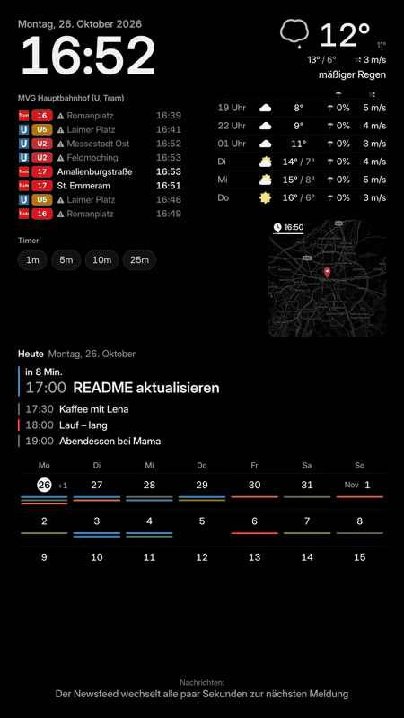
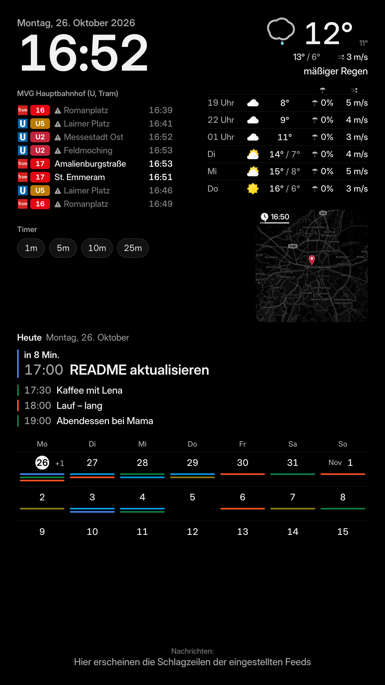
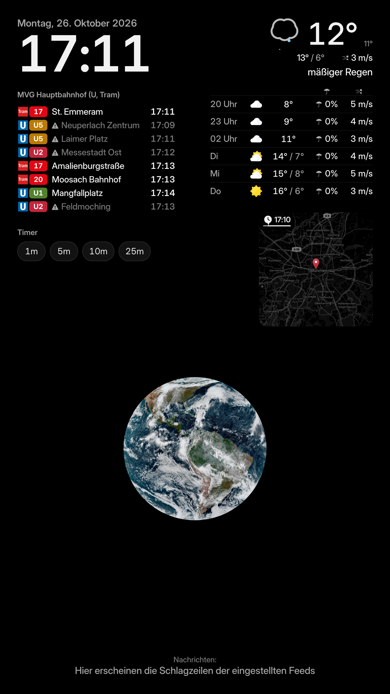
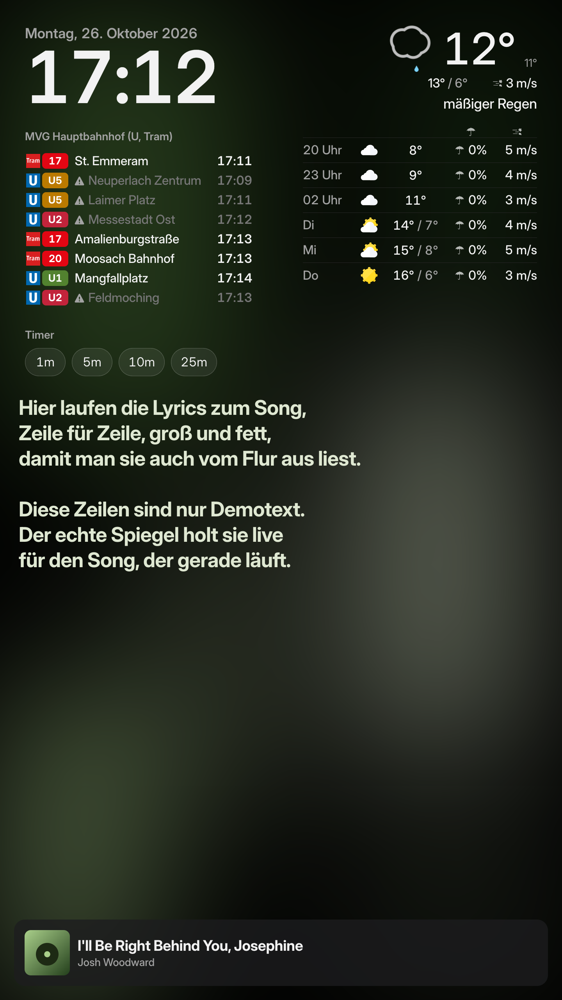
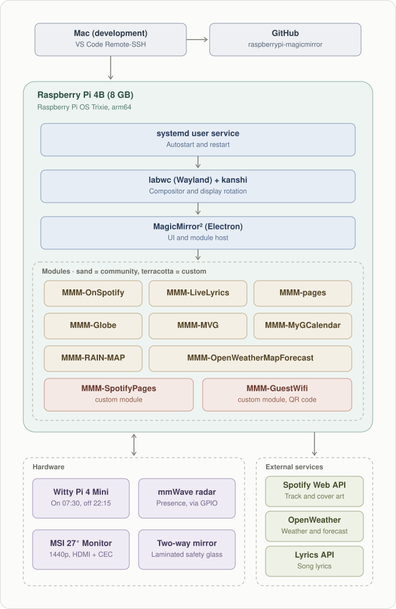

# raspberrypi-magicmirror

A wall-mounted smart mirror built on MagicMirror², running on a Raspberry Pi 4B behind two-way mirror glass.
What makes it more than a dashboard is that the display reacts to state instead of rotating on a timer: it switches to the now-playing page by itself when music starts, shows the rain radar only while it rains, holds a guest Wi-Fi page on request without disturbing the rotation — opened with a hand swipe, recognised by a time-of-flight sensor instead of a camera — and puts the panel into standby when nobody is in front of it.

<p align="center">
  
</p>
<p align="center"><em>Idle pages → a track starts → now playing with lyrics → guest Wi-Fi</em></p>

---

## The pages

| Departures, calendar & weather | Globe | Now playing | Guest Wi-Fi |
|:-------:|:-------:|:-------:|:-------:|
|  |  |  |  |

Pages 0 and 1 rotate slowly while nothing is playing. Page 2 appears on its own when playback starts. The guest page is hidden and shown on request.
The clock, the kitchen timer and system alerts stay on every page. The rain radar joins pages 0 and 1 only while it rains.

<sub>Rendered from this repository's `config/config.js` with demo data for the calendars, weather and news;
departures and radar are live. Regenerate with [`docs/demo/render/render.sh`](docs/demo/render/render.sh).</sub>

### How the pages are driven

`MMM-pages` only knows *which* modules belong to which page; its own timer is switched off. The custom
controller `MMM-SpotifyPages` decides *when* to switch:

| State | Page shown |
|---|---|
| Nothing playing | idle pages 0 ↔ 1, rotating every 5 minutes |
| Playback running | page 2 (player and lyrics), held for as long as the music plays |
| Playback paused or stopped | back to the idle rotation after a 30 s grace period (no jumping between tracks) |
| Hidden page active (guest Wi-Fi) | controller stays out of the way until the page is left or times out after 60 s |

Page switches are throttled, because a second switch during `MMM-pages`' fade animation can leave modules
locked and invisible. Details: [`docs/mmm-spotifypages.md`](docs/mmm-spotifypages.md).

Independently of MagicMirror, a 24 GHz mmWave radar puts the monitor into standby over HDMI-CEC after two
minutes without presence, and a Witty Pi 4 Mini powers the Pi down at night — on local time across
daylight saving changes.

A swipe in front of the mirror opens and closes the guest page. The sensor is a DFRobot SEN0628, an 8×8
time-of-flight sensor that measures distances only — no image of anyone passing by is ever taken
([ADR-007](docs/adr/007-gesture-sensor.md), [`docs/sen0628.md`](docs/sen0628.md)).

---

## Design

The mirror is read in passing, from one or two metres, through glass that turns every lit pixel into
light and every black pixel into mirror. One stylesheet, [`config/custom.css`](config/custom.css), gives
every module the same design system, measured against Apple's Human Interface Guidelines
([ADR-012](docs/adr/012-visual-design.md)):

- **Black glass.** No cards, fills or boxes behind content; hierarchy comes from size and weight.
- **One typeface.** Inter, the open counterpart to SF Pro, never thinner than Regular — thin cuts break up
  behind the glass.
- **Three label greys.** `#f2f2f2` 18.8:1, `#a3a3a3` 8.3:1, `#767676` 4.6:1 on black; nothing below 28 px.
- **Colour only from content.** MVG line colours, calendar colours, weather icons, the radar and the
  album art. The interface itself is monochrome; red is the one signal colour.
- **One large element.** The clock, set like a Lock Screen. Disrupted lines carry a symbol, not just a
  grey; the kitchen timer is a quiet row of presets until it runs.

The values live as CSS custom properties (`--mirror-label`, `--mirror-caption`, …) that the calendar fork
and the guest module read as well.

---

## Architecture

<p align="center">
  
</p>

Custom modules and the stylesheet live in this repository and are symlinked into the MagicMirror tree, so
the MagicMirror installation itself stays an unmodified upstream checkout. Third-party modules are cloned
at pinned commits by [`scripts/bootstrap.sh`](scripts/bootstrap.sh) from the manifest in
[`modules.txt`](modules.txt).

Design decisions are recorded as ADRs in [`docs/adr/`](docs/adr/).

---

## Software stack

| Layer | Choice |
|---|---|
| OS | Raspberry Pi OS (Debian 13 "Trixie", arm64) |
| Display server | Wayland with the labwc compositor; `kanshi` for persistent rotation |
| Application | MagicMirror² 2.37 under Electron |
| Look and feel | `config/custom.css`, Inter from `fonts-inter-variable` ([ADR-012](docs/adr/012-visual-design.md)) |
| Process management | systemd **user** service, logging to the journal |
| CI/CD | GitHub Actions; the Pi pulls CI-green commits from `main` ([ADR-009](docs/adr/009-pull-based-deployment.md)) |
| Updates | Module pins move by weekly pull request; Debian security updates only ([ADR-011](docs/adr/011-reviewable-updates.md)) |
| Monitoring | Health check every minute, alerts on the mirror and by ntfy push ([ADR-010](docs/adr/010-health-check-alerts.md)) |
| Display power | HDMI-CEC via `/dev/cec0`, driven by the presence sensor ([ADR-002](docs/adr/002-display-power-cec.md)) |
| Power schedule | Witty Pi 4 Mini, on 07:30 / off 22:15 ([ADR-005](docs/adr/005-power-management.md)) |

---

## Setup

Full installation, from a fresh Raspberry Pi OS image to a running mirror:
**[`docs/setup.md`](docs/setup.md)**

> [!IMPORTANT]
> **Credentials never belong in this repository.** `config/secrets.js` is git-ignored;
> [`config/secrets.example.js`](config/secrets.example.js) lists the required keys without values.
> A versioned pre-commit hook blocks common secret patterns — enable it once per clone with
> `git config core.hooksPath .githooks`. See [ADR-006](docs/adr/006-secrets-handling.md).

---

## Modules

### Own modules

| Module | Purpose |
|---|---|
| [`MMM-SpotifyPages`](modules/MMM-SpotifyPages/) | Invisible controller. Reads the playback state and drives `MMM-pages` as described above. |
| [`MMM-GuestWifi`](modules/MMM-GuestWifi/) | Renders a Wi-Fi QR code on a hidden page, so guests can join without being told the password. |

### Third-party modules

Pinned in [`modules.txt`](modules.txt). Modules marked `hold` are moved by hand only — an own fork, or a
patch applied by `bootstrap.sh`.

| Module | Purpose |
|---|---|
| [`MMM-pages`](https://github.com/edward-shen/MMM-pages) | Splits modules across pages and handles switching, including hidden pages. Its own rotation is disabled — `MMM-SpotifyPages` drives it. Patched so self-hiding modules aren't locked out ([setup.md](docs/setup.md#what-the-mmm-pages-patch-does)). |
| [`MMM-MyGCalendar`](https://github.com/bikenthusiast/MMM-MyGCalendar) | Own fork with a mirror layout: today's appointments with relative times on top, three weeks of colour bars below. Four iCal feeds, private events shown as "Termin". |
| [`MMM-OnSpotify`](https://github.com/Fabrizz/MMM-OnSpotify) | Playback state and cover colours from the Spotify Web API, read-only scopes. Hidden; it feeds the page controller and the lyrics. |
| [`MMM-LiveLyrics`](https://github.com/Fabrizz/MMM-LiveLyrics) | Lyrics for the current track, with the now-playing card. |
| [`MMM-MVG`](https://github.com/KoblerS/MMM-MVG) | Live departures with absolute times for the nearby Munich public transport stop. |
| [`MMM-OpenWeatherMapForecast`](https://github.com/MarcLandis/MMM-OpenWeatherMapForecast) | Current conditions and forecast (One Call API 3.0). |
| [`MMM-RAIN-MAP`](https://github.com/jalibu/MMM-RAIN-MAP) | Animated precipitation radar from LibreWXR on a dark grey map; shows only while it rains. |
| [`MMM-Globe`](https://github.com/LukeSkywalker92/MMM-Globe) | Full-disk satellite image of the Earth (NOAA GOES-16), refreshed every 10 minutes. |
| [`MMM-KitchenTimer`](https://github.com/bwente/MMM-KitchenTimer) | Kitchen timer with 1, 5, 10 and 25 minute presets and an alarm sound. |
| [`MMM-Remote-Control`](https://github.com/Jopyth/MMM-Remote-Control) | HTTP API — used here to trigger the hidden page from outside. |

### Built in

`clock`, `newsfeed` and `alert` ship with MagicMirror² and need no separate repository. `clock`,
`MMM-KitchenTimer` and `alert` are configured as `fixed` in `MMM-pages`, so they stay visible across all
pages. The built-in `updatenotification` is disabled: module updates arrive as a weekly pull request instead
([docs/updates.md](docs/updates.md)).

---

## Guest Wi-Fi page

```bash
./scripts/guest-page.sh show    # show the QR code
./scripts/guest-page.sh hide    # back to the rotation (happens by itself after 60 s)
```

The script reads the API key from `config/secrets.js` and calls MMM-Remote-Control on `localhost:8080`.
A swipe left in front of the mirror does the same, a swipe right hides it again.

---

## Demo pictures

The GIF and the screenshots above are rendered, not filmed:

```bash
docs/demo/render/render.sh
```

On the development machine it builds a throwaway MagicMirror with `bootstrap.sh` — the same pins, patches
and stylesheet as on the Pi — swaps the secrets for a local demo backend, and drives the pages in headless
Chrome. Needs Chrome, ffmpeg and GNU sed; details in the script's header.

---

## Documentation

| Document | Content |
|---|---|
| [`docs/setup.md`](docs/setup.md) | Rebuild from a blank SD card |
| [`docs/hardware.md`](docs/hardware.md) | Components, GPIO assignment, wiring, frame, Witty Pi schedule |
| [`docs/roadmap.md`](docs/roadmap.md) | Phases, status and what changed against the plan |
| [`docs/adr/`](docs/adr/) | Architecture decision records, including the visual design ([ADR-012](docs/adr/012-visual-design.md)) |
| [`docs/cicd/`](docs/cicd/) | CI checks, CI-gated pull deployment on the Pi |
| [`docs/updates.md`](docs/updates.md) | Weekly module-pin pull requests and OS security updates |
| [`docs/monitoring.md`](docs/monitoring.md) | Health check, alerts, self-healing, hardware watchdog |
| [`docs/sen0628.md`](docs/sen0628.md) | The time-of-flight gesture sensor |
| [`CHANGELOG.md`](CHANGELOG.md) | What changed in each version |
| [`docs/upgrading-to-2.0.md`](docs/upgrading-to-2.0.md) | Upgrade steps from 1.0 |
| [`docs/mmm-spotifypages.md`](docs/mmm-spotifypages.md) | The page controller in detail |
| [`docs/logging.md`](docs/logging.md) | Journal setup and log troubleshooting |
| [`docs/troubleshooting-spotifypages.md`](docs/troubleshooting-spotifypages.md) | Page locks and the Spotify token refresh loop |

---

## License

MIT — see [`LICENSE`](LICENSE). Third-party modules are cloned at install time and remain under their own
licenses; see the linked repositories.

## Credits

The track in the 1.0 demo recording [`docs/demo/demo_magicmirror.mp4`](docs/demo/demo_magicmirror.mp4) is
*I'll Be Right Behind You, Josephine* by [Josh Woodward](https://www.joshwoodward.com/), licensed under
[CC BY 4.0](https://creativecommons.org/licenses/by/4.0/). The rendered demo uses placeholder text.
