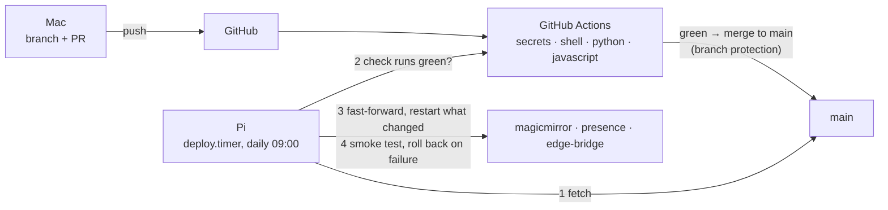

# CI/CD

How a change gets from a commit to the wall, and what checks it on the way. The reasoning is in
[ADR-009](../adr/009-pull-based-deployment.md).



---

## CI

Workflow: [`.github/workflows/ci.yml`](../../.github/workflows/ci.yml). Runs on every push and on pull
requests to `main`.

| Job | What it checks | Fails when |
|---|---|---|
| `secrets (gitleaks)` | the commits of the push | a token, key or password pattern is found — the server-side twin of the pre-commit hook (ADR-006) |
| `shell (shellcheck)` | `scripts/*.sh`, `.githooks/pre-commit`, `docs/demo/*.sh` | a warning or error |
| `python (ruff + pytest)` | ruff on `scripts/` and `tests/`; `tests/test_*.py` on Python 3.13 | a lint error or a failing test |
| `javascript` | `node --check` for modules and config; `config.js` loads with `secrets.example.js`; `tests/js/*.test.js` against MMM-pages from `modules.txt` | a syntax error, a config that does not load, a failing module test |

### Running the same checks locally

```bash
shellcheck -S warning scripts/*.sh .githooks/pre-commit docs/demo/*.sh
ruff check --select E,F,W,B --line-length 120 scripts tests
python3 -m pytest -q tests
for f in modules/*/*.js config/*.js tests/js/*.js; do node --check "$f"; done
MMM_PAGES=~/Projects/MagicMirror/modules/MMM-pages/MMM-pages.js node --test tests/js/*.test.js
```

### Branch protection

Once, on GitHub: *Settings → Branches → Add branch ruleset* for `main`:

- Require a pull request before merging
- Require status checks to pass: `secrets (gitleaks)`, `shell (shellcheck)`, `python (ruff + pytest)`,
  `javascript (syntax, config, module tests)`
- Block force pushes

The check names appear in the list only after the workflow has run once, e.g. on the PR that adds it.

---

## CD

### How a deployment runs

`scripts/deploy.sh`, started by the user timer `deploy.timer` once a day at 09:00 (inside the Witty Pi
window, ADR-005; a run missed while the Pi was off happens right after the next start). A merge to
`main` therefore reaches the wall the next morning — or at once with `systemctl --user start deploy`:

1. **Preconditions:** the checked-out branch is `main` and there are no local changes to tracked
   files. Otherwise it logs why and stops.
2. **Fetch.** Nothing new on `origin/main` → done. Not a fast-forward → stop.
3. **CI gate:** every check run for the new commit is `completed` and `success` / `skipped` / `neutral`.
   Still running, failed, or no checks at all → wait for the next run.
4. **Fast-forward** and restart only what the changed paths need:

   | Changed path | Action |
   |---|---|
   | `modules/**`, `config/config.js` | `systemctl --user restart magicmirror` |
   | `scripts/presence.py` | `sudo systemctl restart presence` |
   | `scripts/edge_bridge.py` | `sudo systemctl restart edge-bridge` |
   | `systemd/**` | reported: install the unit by hand |
   | `modules.txt`, `scripts/bootstrap.sh` | reported: run `scripts/bootstrap.sh` |
   | `config/*.example*` | reported: compare with the local copy |
   | anything else (docs, tests, `guest-page.sh`, …) | nothing — read fresh on every call |

5. **Smoke test:** MagicMirror answers on `http://localhost:8080` within 120 s, and every restarted unit is
   `active`.
6. **On failure:** `git reset --hard` to the previous commit, restart the same services, and write the failed
   commit to `~/.local/state/mirror-deploy/failed-commit`. That commit is skipped from then on; the next
   commit on `main` is tried normally.

Check what a range of commits would do, without touching anything:

```bash
scripts/deploy.sh --plan HEAD~5 HEAD     # which restarts / manual steps
scripts/deploy.sh --dry-run              # full check incl. CI gate, no changes
```

### Installation on the Pi

**1. Fetch over HTTPS.** The repository is public, so reading needs no key. This also avoids a
passphrase-protected SSH key blocking the timer. Pushing from the Pi, if ever, keeps using SSH:

```bash
cd ~/Projects/raspberrypi-magicmirror
git remote set-url origin https://github.com/bikenthusiast/raspberrypi-magicmirror.git
git remote set-url --push origin git@github.com:bikenthusiast/raspberrypi-magicmirror.git
```

**2. Allow exactly the restarts the script needs, without a password:**

```bash
sudo tee /etc/sudoers.d/mirror-deploy >/dev/null <<'RULE'
tobiask ALL=(root) NOPASSWD: /usr/bin/systemctl restart presence, /usr/bin/systemctl restart edge-bridge
RULE
sudo chmod 440 /etc/sudoers.d/mirror-deploy
sudo visudo -cf /etc/sudoers.d/mirror-deploy
```

**3. Clean working tree.** `git status` must not show modified tracked files. Commit them via the Mac,
or `git stash` them.

**4. Timer:**

```bash
cp systemd/deploy-user.service ~/.config/systemd/user/deploy.service
cp systemd/deploy-user.timer   ~/.config/systemd/user/deploy.timer
systemctl --user daemon-reload
scripts/deploy.sh --dry-run                       # first run by hand
systemctl --user enable --now deploy.timer
systemctl --user list-timers deploy.timer
```

Lingering is already enabled for the MagicMirror user service (docs/setup.md), so the timer runs without
a login.

### Operation

```bash
journalctl --user -u deploy -n 50                 # what the last runs did
journalctl --user -u deploy --since today | grep -E "deployed|rolled back|MANUAL"
systemctl --user list-timers deploy.timer         # next and last run (NEXT / LAST)
systemctl --user status deploy.timer              # same, plus "Trigger:" line
systemctl --user start deploy                      # deploy now instead of waiting
rm ~/.local/state/mirror-deploy/failed-commit      # retry a commit that failed the smoke test
systemctl --user disable --now deploy.timer        # pause deployments (e.g. while recording sensor data)
```

Rolling back by hand to a known good commit:

```bash
git reset --hard <sha>
systemctl --user restart magicmirror
```

The next timer run fast-forwards to `main` again. To stay on the old commit, pause the timer, or revert the
commit on `main` (the cleaner way).

### Limits

- The smoke test checks that services are up, not that the mirror looks right.
- Changes to systemd units, the module manifest and templates need a manual step. The log line starts with
  `MANUAL STEP`.
- Third-party modules are not updated by this pipeline; `modules.txt` and `scripts/bootstrap.sh` handle
  them.
- Secrets never pass through it: `config/secrets.js`, `/etc/magicmirror/*.env` and `guest-wifi.png` are
  git-ignored or outside the repo, and `git reset --hard` does not touch ignored files.
