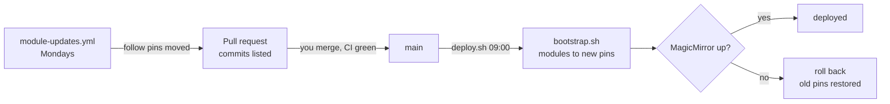

# Updates: modules and operating system

How the mirror stays current without anything changing behind your back. The reasoning is in
[ADR-011](adr/011-reviewable-updates.md).

| What | How it updates | Who decides | Where you see it |
|---|---|---|---|
| Third-party modules marked `follow` | Weekly pull request moves their pins | You, by merging | The PR; `deploy` log next morning |
| Modules marked `hold` | Only by hand | You | Listed as "held back" in the weekly PR |
| Debian security updates | Daily, `unattended-upgrades` at 10:30 | Automatic | `journalctl -t unattended-upgrade`; alert if one is still pending after 2 days |
| Everything else in the OS (kernel, firmware, Raspberry Pi archive, point releases) | `sudo apt full-upgrade`, monthly | You | `os_updates=` in the health-check line; phone reminder after 35 days |



---

## Modules

### Policy per module

The fourth column of [`modules.txt`](../modules.txt):

- **`follow`** — the weekly workflow may move the pin to the newest commit on upstream's default branch.
- **`hold`** — never moved automatically. For your own fork (MMM-MyGCalendar), modules that
  `bootstrap.sh` patches (MMM-OnSpotify, MMM-LiveLyrics, MMM-pages), and upstreams known to break this setup
  (MMM-Globe). Put the reason after a `#`; it shows up in the PR.

A line without a policy counts as `hold`.

### The weekly pull request

[`.github/workflows/module-updates.yml`](../.github/workflows/module-updates.yml) runs on Mondays (and on
demand: *Actions → Module updates → Run workflow*). It calls
[`scripts/module-updates.sh --write`](../scripts/module-updates.sh), which asks each upstream for its head
(`git ls-remote`, no clone) and moves the `follow` pins. If anything moved, it opens one PR on the branch
`bot/module-pins`, or refreshes the open one. The PR lists per module:

- the new commits (newest ten) and a compare link,
- **dependencies changed** when `package.json` changed — `npm install` then pulls new third-party code,
- **diverged** when the old pin is not an ancestor of upstream's head (history rewritten),
- the `hold` modules whose upstream has moved, for information.

Before merging, read the commits. To keep one module back, set it to `hold` in a commit on `main` and close
the PR; the next run proposes the rest again.

The same check locally, without changing anything:

```bash
scripts/module-updates.sh                 # report only
scripts/module-updates.sh --write         # move the follow pins in modules.txt
```

### What happens on the Pi

After the merge, `deploy.sh` (09:00, [CI/CD](cicd/README.md)) sees `modules.txt` changed and

1. runs `bootstrap.sh`: fetches and checks out only the modules whose pin is new, runs `npm install` only
   where the checked-out commit changed, re-applies the node-fetch and MMM-pages patches, checks the
   patched files parse.
   Moving a module discards local changes to its tracked files — `npm install` rewrites
   `package-lock.json` in some modules (MMM-Remote-Control), which would otherwise block the checkout;
2. restarts MagicMirror and waits for it to answer;
3. on any failure resets the repo to the previous commit and runs `bootstrap.sh` again, which puts the
   modules back on their old pins.

The smoke test sees MagicMirror answer, not whether each module shows the right thing. After a module
update the deploy log therefore also counts the `ERROR` lines MagicMirror wrote since the restart:

```bash
journalctl --user -u deploy -n 50
journalctl -t magicmirror --since today | grep ERROR
```

### Undo a module update

Revert the merge commit on `main` (GitHub: *Revert* on the PR). The next deploy runs `bootstrap.sh` with the
old pins. Quicker for one module: set its old pin and `hold` in `modules.txt`.

---

## Operating system

### Set up once

```bash
cd ~/Projects/raspberrypi-magicmirror
sudo scripts/setup-os-updates.sh          # installs unattended-upgrades + config, moves the timers
scripts/setup-os-updates.sh --check       # what is installed, which origins, next timer runs
sudo unattended-upgrade --dry-run --debug 2>&1 | grep -iE "allowed origins|packages that will be upgraded"
```

It installs three files from [`config/os/`](../config/os/):

| File | Target | Effect |
|---|---|---|
| `52unattended-upgrades-mirror` | `/etc/apt/apt.conf.d/` | Daily run on; **only** `Debian-Security` (the distribution's list is cleared with `#clear`); no automatic reboot; results in the journal |
| `apt-daily.timer.conf` | `/etc/systemd/system/apt-daily.timer.d/mirror.conf` | Package lists at 10:00 instead of 06:00/18:00 with up to 12 h delay |
| `apt-daily-upgrade.timer.conf` | `/etc/systemd/system/apt-daily-upgrade.timer.d/mirror.conf` | Install at 10:30 |

Both times sit inside the Witty Pi window (07:30–22:15) and after the 09:00 deploy. A run missed while the
Pi was off is caught up after the next start (`Persistent=true` in the units).

No automatic reboot is needed: the Witty Pi powers the Pi off every night, so an updated library or kernel
is in use the next morning. The health-check line shows `reboot=pending` until then.

When `config/os/` changes on `main`, `deploy.sh` logs a `MANUAL STEP`: run `sudo scripts/setup-os-updates.sh`
again.

### Monthly: everything else

Kernel, firmware, labwc, Chromium and the rest come from the Raspberry Pi archive or Debian point releases
and touch exactly what is fragile here (UART5, CEC, Wayland output). They wait for a deliberate update:

```bash
sudo apt update
apt list --upgradable                     # read it
sudo apt full-upgrade
sudo reboot                               # then check: display, CEC standby, gestures, presence
```

The health check counts pending updates (`os_updates=` and `sec=` in every journal line, refreshed hourly
from apt's package lists) and sends a low-priority phone reminder when updates have been waiting for 35
days. If a **security** update is still pending after 2 days, `unattended-upgrades` is not doing its job
and the alert says so ([monitoring.md](monitoring.md)).

### The update popup at boot

The "updates available" notice on the desktop comes from the `updater` widget of the taskbar
(`wf-panel-pi`). On the mirror it only flashes up before MagicMirror covers the screen, and the health
check reports the same information. The widget list lives in `/etc/xdg/wf-panel-pi/wf-panel-pi.ini`,
which package updates overwrite; a copy of the line without `updater` in the user file takes precedence:

```bash
sys=/etc/xdg/wf-panel-pi/wf-panel-pi.ini
usr=~/.config/wf-panel-pi/wf-panel-pi.ini
sect="$(awk '/^\[/{s=$0} /^widgets_right=/{print s; exit}' "$sys")"
line="$(grep -m1 '^widgets_right=' "$sys" | sed 's/ updater//')"
touch "$usr"; cp "$usr" "$usr.bak"
if grep -q '^widgets_right=' "$usr"; then
  sed -i "s|^widgets_right=.*|$line|" "$usr"
elif [ -n "$sect" ] && grep -qxF "$sect" "$usr"; then
  sed -i "/^$(printf '%s' "$sect" | sed 's/[][]/\\&/g')\$/a $line" "$usr"
else
  printf '%s\n%s\n' "$sect" "$line" >> "$usr"
fi
cat "$usr"        # [panel] / widgets_right=... without updater; takes effect after a reboot
```

Done on the mirror on 23.10.2026 (Trixie). Side effect: the user file now fixes the right-hand widget
list, so widgets added by later panel versions do not appear there.
